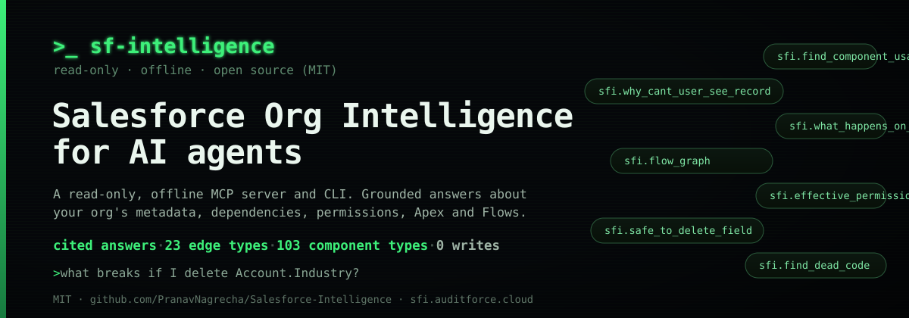
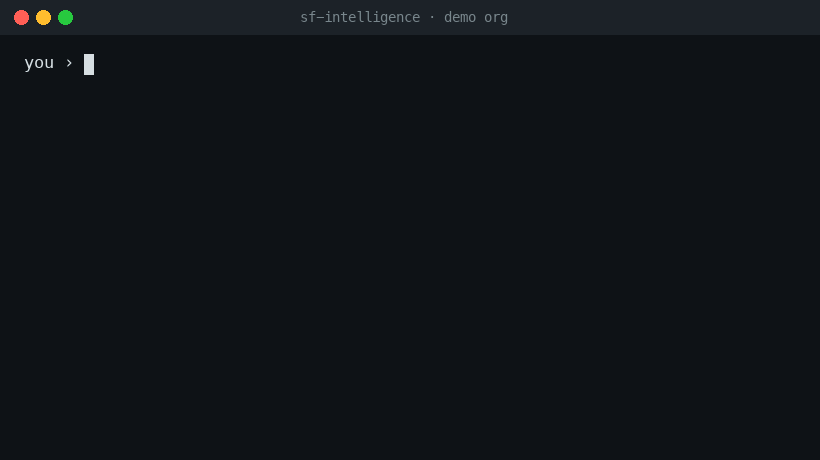
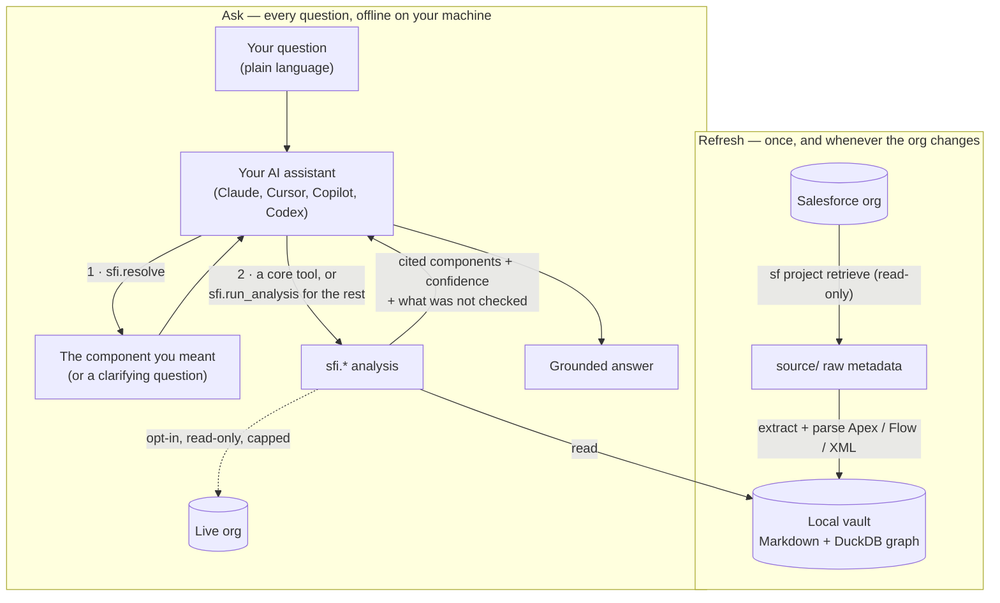

<p align="center">
  
</p>

<p align="center">
  <a href="./LICENSE"></a>
  <a href="https://www.npmjs.com/package/sf-intelligence"></a>
  <a href="https://github.com/PranavNagrecha/Salesforce-Intelligence/actions/workflows/ci.yml"></a>
  = 20">
  
  <a href="https://sfi.auditforce.cloud"></a>
</p>

# sf-intelligence

**Know what breaks before you change Salesforce.** Ask the AI assistant you already use about your org. sf-intelligence runs on your computer, never writes to your org, and every answer names the components it came from.

<p align="center"></p>

**Website, demo and docs: [sfi.auditforce.cloud](https://sfi.auditforce.cloud)** · Works in Claude Code, Claude Desktop, Cursor, VS Code + Copilot and Codex.

## What it answers

The questions below were checked by an outside reviewer against a real production org (about 4,700 components) by reading the raw metadata. The answers were right.

| Ask | What you get back |
|---|---|
| **Where is this field used?** | Every Apex class, flow, layout, validation rule, report and page that references it, each with how it was found (declared, parsed or heuristic) |
| **Can I delete this field?** | A verdict (safe, risky, blocking, review) with the reasons and the components behind each one, plus what was *not* checked |
| **What happens when I save a record?** | The save order for one object and one event: triggers, validation rules, flows, approvals, in the sequence they run |
| **Which Apex is dead?** | Classes and triggers nothing calls, with the honest tier (definitely, likely, uncertain) and why |
| **Who can see or edit this?** | Effective permissions from profile plus permission sets, and why a given user cannot see a record |

A real answer from the built-in demo org (a solar installer called Verdant), unedited:

> **Can I delete `Project__c.Risk_Score__c`?** Not safe to delete: **blocking**. `ProjectTriggerHandler` writes it and `ProjectTriggerHandlerTest` reads it (parsed from the Apex); the Residential page layout shows it (declared). Checked: Apex, flows, workflow rules, validation rules, layouts. Not checked: assignment, auto-response and escalation rules, because they were not retrieved.

## Try it in three commands

```bash
npm install -g sf-intelligence
sfi demo            # a built-in demo org, no Salesforce login needed
sfi init            # then: connect your own org (read-only retrieve)
```

Then register the server in your AI host; the [install guide](./llms-install.md) has the exact block for each host. Or one click: [](https://cursor.com/install-mcp?name=sf-intelligence-demo&config=eyJjb21tYW5kIjoibnB4IiwiYXJncyI6WyIteSIsInNmLWludGVsbGlnZW5jZSIsImRlbW8iXX0%3D) Try the built-in demo org in Cursor in one click (no Salesforce login). AI agents installing this server: see [llms-install.md](llms-install.md).

By default your assistant sees 16 tools: the eight that answer the questions above and eight that help it find its way (`sfi.resolve`, `sfi.search_components`, `sfi.get_component`, `sfi.health_check`, `sfi.list_analyses`, `sfi.describe_analysis`, `sfi.run_analysis`, `sfi.live_consent`). Every other analysis sits behind one gateway tool, `sfi.run_analysis`, and is listed by `sfi.list_analyses`. The vault is a local folder, answers are served offline, and the optional live read-only plane is off until you turn it on. What your AI assistant does and does not see is in [Privacy](#privacy).

**For engineers:** how the vault, the dependency graph and your assistant fit together is in [How it works](#how-it-works); what is deliberately not modeled is in [What it does NOT do](#what-it-does-not-do).

## Ask it like a person

You don't need to know the exact API name of anything. A typo-tolerant resolver
turns messy phrasing into the right component, and when it isn't sure it
**asks you a clarifying question** instead of guessing:

> **You:** where's the emale field?
>
> **It:** I found several matches for "email" — which did you mean?
> · `Email__c` on `Account`
> · `Email__c` on `Contact`
> · `Alternate_Email__c` on `Lead`

> **You:** what about the paymnet object?
>
> **It:** `Payment__c` — one confident match.

> **You:** is there a "warranty fee" field?
>
> **It:** Nothing matched that confidently. Your vault was last refreshed on
> 2026-05-20 — want to pull fresh metadata from the org (`/sfi-refresh`) in case
> it's new, or rephrase?

It never silently commits to a guess. When several components are plausible it
asks which you meant; when nothing matches it offers to refresh from the org or
stop. A high match score is string similarity, not proof.

## How it works

One read-only **refresh** turns your org into a local vault: the raw metadata,
one Markdown page per component, and a dependency graph. From then on every
question is answered **offline**. Your AI assistant resolves the name you used,
calls one of the 16 default tools (or `sfi.run_analysis` for any other
analysis), and builds its answer only from what came back, citing each
component.



Every box on the **Ask** path runs on your machine; the dotted edge to the live
org is the only one that can touch Salesforce, and only after you opt in.

### How it stays honest

Every answer is built from tool output, never from general Salesforce
knowledge. Each relationship carries how it was found: `declared` (stated in
the metadata), `parsed` (from Apex, Flow or formula source) or `heuristic`
(pattern matching, so spot-check before acting). Each answer says which
metadata families were checked and which were not, so "nothing references
this" always means "no evidence in what was retrieved". A request to change
the org is refused and answered with the read-only check that fits instead.
For "what does this imply" questions, a deterministic, offline concept model
of general Salesforce truth (never your org's data) adds cited structural
claims, such as a master-detail cascade delete or two flows with an undefined
order. The details: [routing and refusal](./docs/routing.md),
[architecture and the trust boundary](./docs/architecture.md),
[asking questions](./docs/guides/asking-questions.md),
[ADR-001 confidence-tagged edges](./docs/decisions/ADR-001-confidence-tagged-edges.md)
and [ADR-008 deterministic reasoning](./docs/decisions/ADR-008-deterministic-concept-model-reasoning.md).

## What you can ask

Every area answers in plain language; ask "what can you do?" for the live map.

| Area | Example questions |
| --- | --- |
| **Find & identify** | "where is the email field?" · "what's the payment object called?" |
| **Understand** | "what does this validation rule do?" · "what happens when an Account is saved?" (automation on standard objects works even when the object itself was not retrieved; the answer says so) |
| **Impact & dependencies** | "what breaks if I delete this field?" · "is it safe to deactivate this flow?" |
| **Permissions & sharing** | "why can't this user see this record?" · "who can edit the Salary field?" · "who holds the Sales Manager permission set?" (live) · "what does user Jane hold?" (live) · "who's in the Support queue?" (live) · "which active users have zero permission-set assignments?" (live) |
| **Automation & code** | "what runs on Case create?" · "which Apex methods have no real test coverage?" · "decode this Apex debug log / governor-limit exception to the class that ran" |
| **Decision-support (before you build/change)** | "before I add automation to this object, what already runs there?" · "building Apex here — what should I watch out for?" · "before I change/require this field, what breaks?" |
| **Architect & developer** | "are there circular Apex dependencies?" · "which classes have no test reference?" · "does the vault still match the live org?" |
| **Integrations** | "what external systems does this org talk to?" · "list every outbound endpoint" |
| **Documentation** | "give me a tour of this org" · "generate a data dictionary" · "which reports / objects / permission sets have no description?" |
| **Health & audit** | "is my vault fresh?" · "where is PII stored?" · "how has the org changed across refreshes?" |

All of these are read-only briefings; none of them write to the org. Every
component an answer names is backed by a tool call and cited with its
canonical id (`CustomObject:Account`, `CustomField:Account.Industry__c`), and
every relationship with its confidence (`declared`, `parsed` or `heuristic`).
The full catalog with the live counts comes from `sfi.capabilities` (through
`sfi.run_analysis`) or the [tools page](https://sfi.auditforce.cloud/tools);
the counts are pinned by `eval/product-manifest.json`, never typed by hand.

## What it does NOT do

Boundaries are explicit, and the product tells you plainly when it hits one
rather than papering over the gap with general Salesforce knowledge:

- **Offline by default.** Vault tools never call Salesforce mid-conversation.
  Run `/sfi-refresh` (or `sfi refresh`) to update metadata. The opt-in live
  tools (`sfi.live_*`) run read-only queries with strict caps and label their
  answers `live_org`. They stay off until you grant consent once per org with
  `sfi.live_consent { grant: true }` (bound to the org and user, scoped,
  expiring, stored locally) or set `SFI_LIVE_PLANE_ENABLED=1`. A per-call
  `liveEnabled: true` is intent only, not consent. Hybrid answers combine the
  vault and the live org and say so. The product never picks which org to
  query on its own.
- **No record-level data.** The vault stores schema and source, not rows. "How
  many Opportunities closed last quarter" is a question for your org directly.
- **Static analysis, not runtime.** Dependency edges come from metadata and
  source. Dynamic SOQL, reflective Apex and runtime metadata lookups are
  invisible to it, so "no references found" means "no static evidence", not
  "definitely unused".
- **Reasoning is rule matching, not an LLM and not a live check.** A
  structural claim names a pattern in the code and metadata shape and cites
  the ids it matched. A governor or security concept is a signal, not a proven
  runtime breach or vulnerability; an empty result means no rule fired, not
  that nothing depends on the component.
- **Read-only.** The product never writes to your org. It has no write path.
- **Tested scale.** CI gates three ceilings: a 10,000-node graph import in
  under 90 s, a 1,000-file `CustomObject` + `CustomField` refresh in under
  10 min, and resolve p95 under 2 s on the CI vault. Very large production orgs
  may still need narrowed retrieves or several vaults.

## Review changes before you deploy (PR gate)

`sfi review-change` is the pre-deploy gate: hand it the components a PR,
`package.xml` or `git diff` touches and it returns a per-component risk verdict
(`blocking` / `risky` / `review` / `safe`), each one's direct dependents and the
tests to run, most dangerous first, entirely offline against the target org's
last vault refresh. A deleted component with any dependent fails **closed**
(`blocking`); a modified component with firm dependents is `risky`; the overall
verdict is the worst across the set. Point it at another vault (`--against`) to
answer "will this changeset break anything in **prod**?" against that org's
graph. The same analysis is `sfi.review_change` over MCP.

The same analysis ships as a GitHub Action: the composite Action at
[`.github/actions/review-change`](./.github/actions/review-change/README.md)
emits SARIF 2.1.0 (findings show up inline on the PR's "Files changed" tab and in
the Security tab) plus a markdown PR comment, with a 0/1/2 exit-code gate. Copy
[`docs/ci/review-change-pr-gate.example.yml`](./docs/ci/review-change-pr-gate.example.yml)
into your org repo to wire it up. It never runs `sfi refresh` and never calls the
`sf` CLI; it only reads an already-built vault.

## Try it now — no Salesforce org needed

Want to see it work before pointing it at your own org? (Or read real answers
from it first, on [sfi.auditforce.cloud/demo](https://sfi.auditforce.cloud/demo).)
One command serves a built-in **synthetic demo org** ("Verdant Energy," a fictional solar installer)
over MCP — fully offline, no auth, no `sf` CLI:

```bash
# Register the demo server with Claude Code (or any MCP client):
claude mcp add --transport stdio --scope user sf-intelligence-demo -- npx -y sf-intelligence demo
```

Then ask it things like:

> - *What happens when I save a Project?*
> - *What breaks if I delete `Invoice__c.Amount__c`?*
> - *Why can't an Installer see an Invoice?*
> - *Which Apex has governor-limit risk?*

The first run builds the demo vault (cached under `~/.sf-intelligence/demo`)
before the server answers, on top of `npx` downloading the package, so the
first start can take 10-20 seconds; every run after is instant. If your client
gives up at startup (Codex allows about 10 seconds by default), raise its
startup timeout (`startup_timeout_sec` in Codex, `MCP_TIMEOUT` in Claude Code)
or start it a second time. Nothing leaves your machine. When you're ready for your real org, follow **Install** below.

## Install

Step-by-step setup for each AI assistant, with copy-paste config: [sfi.auditforce.cloud/getting-started](https://sfi.auditforce.cloud/getting-started).

`sf-intelligence` is distributed on npm as `sf-intelligence` — an MCP
server plus the `sfi` command-line tool. Register the server with your MCP
client once, then drive everything through `sfi` (or, inside Claude Code, the
`/sfi-*` slash commands that wrap it).

**Requirements:** [Node.js 20+](https://nodejs.org) and an authenticated
[Salesforce CLI](https://developer.salesforce.com/tools/salesforcecli) (`sf`)
pointed at the org you want to vault. `npx` fetches everything else.

### Register the MCP server

Every host launches the same command; each reads a **different config file in a
different format**. Pick yours — the full per-host, per-platform detail
(exact paths for macOS and Windows, where the logs are, what to do when it
doesn't connect) is in **[docs/guides/mcp-hosts.md](./docs/guides/mcp-hosts.md)**.
Error messages and what to do about them: **[docs/guides/troubleshooting.md](./docs/guides/troubleshooting.md)**.
Moving from an earlier release: **[docs/guides/upgrading.md](./docs/guides/upgrading.md)**.

| Host | Config file | Top-level key |
|---|---|---|
| Claude Code | `.mcp.json` (project) or `~/.claude.json` | `mcpServers` |
| Claude Desktop | `claude_desktop_config.json` | `mcpServers` |
| Cursor | `.cursor/mcp.json` (project) or `~/.cursor/mcp.json` | `mcpServers` |
| Codex | `~/.codex/config.toml` | `[mcp_servers.*]` (TOML) |
| VS Code + GitHub Copilot | `.vscode/mcp.json` | **`servers`** |

**Claude Code** — from your Salesforce DX repo, add it project-scoped (writes a
`.mcp.json` at the repo root that your team can commit):

```sh
claude mcp add --scope project sf-intelligence -- \
  npx -y sf-intelligence mcp --vault "$PWD/org-kb"
```

**Claude Desktop** — add this block to the client's MCP config
(`~/Library/Application Support/Claude/claude_desktop_config.json` on macOS,
`%APPDATA%\Claude\claude_desktop_config.json` on Windows), then quit and reopen
the app:

```json
{
  "mcpServers": {
    "sf-intelligence": {
      "command": "npx",
      "args": ["-y", "sf-intelligence", "mcp", "--vault", "/abs/path/to/org-kb"]
    }
  }
}
```

**Cursor** — the same block, in `.cursor/mcp.json` at the project root (or
`~/.cursor/mcp.json` for every project). Cursor does not reload the file on
its own: turn the server off and on in Settings → MCP, or restart Cursor.

**VS Code + GitHub Copilot** — create `.vscode/mcp.json` in your project. Note
the top-level key is `servers`, **not** `mcpServers`; pasting the Claude block
here parses fine and registers nothing:

```json
{
  "servers": {
    "sf-intelligence": {
      "type": "stdio",
      "command": "npx",
      "args": ["-y", "sf-intelligence", "mcp"],
      "cwd": "${workspaceFolder}",
      "env": { "SFI_VAULT": "${workspaceFolder}/org-kb" }
    }
  }
}
```

**Codex** — `codex mcp add sf-intelligence -- npx -y sf-intelligence mcp --vault /abs/path/to/org-kb`,
or the TOML equivalent in `~/.codex/config.toml`.

Restart the client. The `sfi.*` tools are now available — ask "what can you
do?" for the live tool map.

> **Always pass an absolute `--vault` path.** The server looks for `./org-kb`
> relative to *its own* working directory, and most hosts pick that directory
> for you — Claude Desktop and a user-scope VS Code server never run inside your
> Salesforce project. `--vault` is what makes the config work anywhere.
>
> **Before your first `sfi refresh`** the server starts in **setup mode**: it
> connects and offers one tool, `sfi.setup_status`, which tells your chat exactly
> what to run next. That is expected — just ask your assistant to set it up.

> **Tip:** `npm install -g sf-intelligence` puts an `sfi` command on your
> PATH, so first-run setup is `sfi init` / `sfi refresh` instead of the longer
> `npx -y sf-intelligence …` form.

### Optional: full roster vs compact core

**Default is the 16-tool core roster** (includes `sfi.live_consent`). Its
`tools/list` is about 21 KB (a test keeps it under 40 KB); the full roster is
about 525 KB, which a host pays before the first question. Non-core tools stay
reachable via `sfi.run_analysis` (byte-identical) and are not directly
invokable under core. Set `SFI_TOOL_PROFILE=full` (or add
`"env": { "SFI_TOOL_PROFILE": "full" }` in the config block above) to advertise
and directly invoke the entire roster. See
[docs/configuration.md](./docs/configuration.md) for the full reference.
Every `sfi` command is described in [docs/cli.md](./docs/cli.md).

### Install as a Claude Code plugin

The MCP registration above gets you the `sfi.*` tools. Installing
`sf-intelligence` as a **Claude Code plugin** additionally gets you **26
skills** that auto-activate on Salesforce vocabulary (no need to remember tool
names) and **5 slash commands** (`/sfi-onboard`, `/sfi-init`, `/sfi-refresh`,
`/sfi-status`, `/sfi-field-audit`) that wrap the `sfi` CLI. Install it from this repo's
marketplace:

```sh
/plugin marketplace add PranavNagrecha/Salesforce-Intelligence
/plugin install sf-intelligence@sf-intelligence
```

Run `/reload-plugins` (or restart Claude Code) to pick it up in the current
session; `/plugin list` confirms it's installed and enabled. The plugin
manifest registers the same MCP server shown above, so you don't need a
separate `claude mcp add` step. It cannot know where your vault is, though: it
passes no `--vault`, so either set `SFI_VAULT` to the absolute path of your
`org-kb` folder (in your shell profile, or in the host's `env` block) or launch
Claude Code from the folder that holds `org-kb`. If answers come back empty,
ask "is the server set up?" and it will say where it looked.

The plugin ships the skills and the slash commands. It does not ship the agent
files under `.claude/agents/`; two of those are maintainer tools, and the two
that `/sfi-field-audit` spawns are available from a clone of this repo, not
from the plugin.

## First run

Work from **your per-org repository** — the Salesforce DX project you want to
vault (the directory with `sfdx-project.json`). The first refresh is read-only:
it retrieves metadata and builds a local knowledge base; it never deploys or
mutates Salesforce data.

```sh
# 0. New here? The guided path walks install → auth → init → refresh → ask,
#    with real starter questions at the end.
sfi quickstart

# 1. Create the local org-kb/ vault layout and record which sf org alias to use.
sfi init

# 2. Retrieve metadata and build the vault.
sfi refresh --target-org my-org-alias

# 3. Confirm vault freshness, source-tree hash, and component counts any time.
sfi status

# sfi doctor checks the sf CLI, the vault, target-org auth, freshness, and the
# graph file, and prints an actionable fix for each problem.
sfi doctor
```

**How long does a refresh take?** A small sandbox builds in a few minutes; a
production-scale org is typically **~10–12 minutes** under the defaults — the
retrieve dominates, and the default build also runs the parser-grade Apex pass
(seconds per few hundred classes) and pulls the **top 500 reports/dashboards by
actual usage** (a minute or two on report-heavy orgs; `--no-reports` skips it).
In a hurry on a big org? `sfi refresh --staged` serves a skeleton vault in
seconds and the ten priority metadata families within minutes, then finishes
the full build behind the scenes — see the
[first-refresh guide](./docs/guides/first-refresh.md). Re-refreshes re-extract
and rebuild the graph in full by default (results always match a cold build);
`--incremental` reuses the per-file parse cache for the same result, faster,
and `--incremental-graph` additionally re-imports only the changed nodes/edges
into the graph instead of rebuilding it — combine both for the largest win.
`--types <list>` scopes either flag to specific metadata types (e.g.
`sfi refresh --types Flow --incremental-graph`); a scoped refresh only ever
touches the requested type(s) — every other type in the vault is left as-is.

No global install? Prefix each with `npx -y sf-intelligence`, e.g.
`npx -y sf-intelligence init`.

Then ask anything the vault can answer, in whatever MCP client you registered:

> What fields does the Account object have?
>
> What breaks if I delete `CustomField:Account.Industry__c`?
>
> Why can't the Standard User profile see Opportunities?
>
> Give me a tour of this org.

**Running sf-intelligence as a Claude Code plugin?** The same operations are
available as slash commands — `/sfi-onboard` (guided first run), `/sfi-init`,
`/sfi-refresh`, `/sfi-status` — and the coaching skills auto-activate when
Salesforce vocabulary appears. See [Install as a Claude Code
plugin](#install-as-a-claude-code-plugin) above if you haven't installed it
that way yet.

### Serve it over HTTP (read-only)

`sfi mcp` is the stdio server your MCP client launches. To share one vault with
other machines or clients, the same server speaks streamable HTTP:

```sh
# From the vault directory: prints a bearer token once, listens on 127.0.0.1:8787.
sfi serve --http --generate-token

# Team path: JSON token→identity map (annotation writes attribute to the caller).
# sfi serve --http --tokens-file ./tokens.json
```

The remote posture is deliberately strict: a bearer token is required on every
request (solo `--token` / `--generate-token`, or `--tokens-file` for per-caller
identity), the bind is loopback unless you pass `--host` (a non-loopback host
warns and refuses to run tokenless), and the **live plane is hard-disabled over
HTTP** — a remote caller can never spend your Salesforce API budget, even if
the host has standing live consent. A refresh underneath a running server is
safe: readers keep answering from the old graph until the new one swaps in.

### Give the vault a memory

```sh
# One-time, from the vault directory: inits a git repo INSIDE org-kb/
# (rebuildable surfaces like graph/ and snapshots/ are gitignored).
sfi vault git enable
```

From then on every refresh commits the vault's source and rendered Markdown, so
"**when did this component change?**" and "**what did it look like before?**"
become answerable from the vault's own history (`sfi.component_history` and
`sfi.component_as_of`, through `sfi.run_analysis`). A vault without git answers
those honestly (`available: false` plus this enable hint), never with an error.

## Privacy

Everything the product does stays on your machine. The vault (`org-kb/`) is a
local folder; the MCP server defaults to `SFI_NETWORK_MODE=off` and makes no
network call while answering vault questions. The only outbound calls are the
ones you ask for: the Salesforce retrieve during `sfi refresh`, a live
read-only query after you grant consent, and an npm update check only when
`SFI_UPDATE_CHECK=1`.

One thing it cannot control: **your AI assistant sees every question and every
answer**, just as it sees anything else you paste into it. The object, field
and class names and the verdicts in an answer go to that assistant's provider
(Claude, Cursor, GitHub Copilot, Codex) under its terms. sf-intelligence itself
uploads nothing. Use an assistant your company approves for its metadata.

This public repository ships **zero org data**: a release privacy guard scans
the shipping set on every release and fails the build if a real org identifier
leaks. What you vault is yours.

## Uninstall

1. Remove the server from your host: `claude mcp remove sf-intelligence`
   (Claude Code; add `--scope project` if you registered it that way), or
   delete the `sf-intelligence` entry from the host's config file named in
   [Install](#install). Remove `sf-intelligence-demo` the same way if you
   added the demo.
2. Installed the Claude Code plugin? `/plugin uninstall sf-intelligence@sf-intelligence`.
3. Running the drift watcher? `sfi watch stop` in the vaulted project.
4. Installed the CLI globally? `npm uninstall -g sf-intelligence`. (`npx`
   installs nothing permanent.)
5. Delete the data: `org-kb/` in each Salesforce project you vaulted,
   `~/.sf-intelligence/` (demo vault, live-consent grants, feedback and
   route-gap logs) and, if you registered vaults for cross-org comparison,
   `~/sf-intelligence-vaults/`.

Nothing is left in your Salesforce org; the product never wrote to it.

## Roadmap

The product is read-only today by design; that is the major axis of future work.

- **Deeper code resolution.** Parsed Apex call edges carry the called method
  names today; the remaining composite tools still reason at class granularity —
  method-level reachability across them is the next step.
- **A careful write side.** A small, opt-in set of *proposal* tools (e.g. draft a
  permission-set diff or a validation-rule edit for human review) once the read
  side is mature. The default will always be read-only.

(Earlier roadmap entries shipped: Tooling-API-backed stale-vault detection is
now the `sfi watch` daemon + drift badges; remote read-only serving is
`sfi serve --http`.)

## Feedback

A weak or wrong answer, or a question it couldn't route? That's the most useful
thing you can send back. It's captured **locally** — nothing phones home:

```sh
sfi feedback mark "where is the SSN field used" --wrong   # or --weak
sfi feedback export                                       # → sfi-feedback.json (scrubbed)
```

`sfi feedback export` bundles the local route-gap log plus your ratings into one
file with org PII (emails, URLs, record ids) stripped — component/api names are
kept because they're the signal. Exports are **scoped to the current vault by
default**: the log file is machine-global (`~/.sf-intelligence/`), but each gap
is stamped with the vault it was asked against, and only the current vault's
gaps are exported (the file reports how many were excluded). `--all` exports
the whole machine-global log — review it before sharing if you work across
multiple orgs. Share it (or just describe the gap) at
<https://github.com/PranavNagrecha/Salesforce-Intelligence/issues>.

## Contributing

Bug reports, feature requests and extractor gaps each have an issue template;
pull requests have a short checklist. Dev setup, the test commands and the
rules for adding a tool are in [CONTRIBUTING.md](./CONTRIBUTING.md); the repo
map is [REPO-STRUCTURE.md](./REPO-STRUCTURE.md). Security reports go through a
[private advisory](https://github.com/PranavNagrecha/Salesforce-Intelligence/security/advisories/new),
never a public issue ([SECURITY.md](./SECURITY.md)).

## License

`sf-intelligence` is licensed under the **[MIT License](./LICENSE)** (see also [`NOTICE`](./NOTICE)). Releases before 0.5.0 carried a Commons Clause condition; it was removed in 0.5.0. In plain English:

- ✅ **Free for any purpose, including commercial use:** use, copy, modify, merge, publish, distribute, sublicense and sell. Keep the copyright and license notice with it. _(Plain-English summary; the [LICENSE](./LICENSE) controls. Not legal advice.)_

## Documentation

- [sfi.auditforce.cloud](https://sfi.auditforce.cloud) — website: [demo answers](https://sfi.auditforce.cloud/demo), [getting started](https://sfi.auditforce.cloud/getting-started), [all tools](https://sfi.auditforce.cloud/tools), [FAQ](https://sfi.auditforce.cloud/faq)
- [Documentation index](./docs/README.md) — guides, architecture, configuration
- [Contributing](./CONTRIBUTING.md) · [Security](./SECURITY.md)
